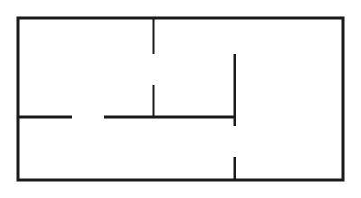

Cet article charge un fichier de style qui lui est propre (`colonnes.css`, rangé dans le même dossier). Les autres pages du site n'en sont pas affectées.

Premier paragraphe, dans la partie en deux colonnes. Le texte coule d'une colonne à l'autre comme dans un journal, et repasse sur une seule colonne sur un petit écran.

Deuxième paragraphe. Le texte reste du Markdown ordinaire ; seule la mise en page change, grâce à la classe `colonnes` déclarée dans le fichier de style.

Troisième paragraphe, pour que la deuxième colonne ait de quoi se remplir. Une phrase un peu plus longue vaut mieux que plusieurs phrases courtes quand on veut vérifier le rendu d'une mise en colonnes.

Retour à une seule colonne pour la fin du texte.
